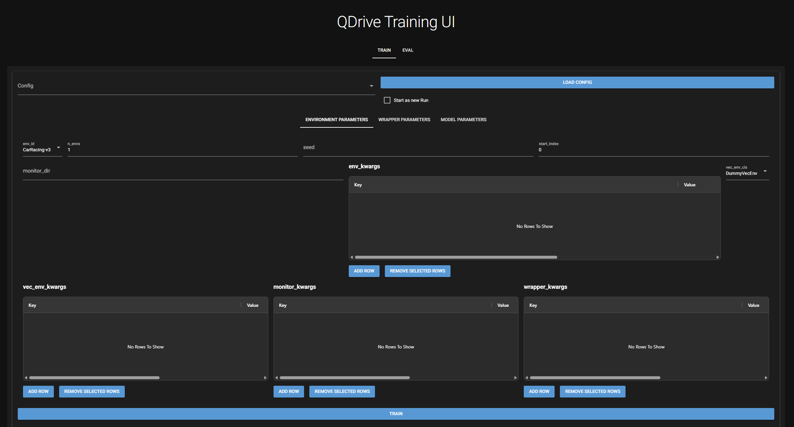

# QDrive

QDrive is a wrapper around [Stable Baselines3](https://github.com/DLR-RM/stable-baselines3) that provides a simple
interface for training and evaluating reinforcement learning agents.



## Features

- **GUI and CLI:** Configure and monitor experiments from the browser or run saved experiment configurations using the
  cli.
- **Discovery:** The GUI discovers available environments, wrappers, and algorithms. This allows plug and play
  integration with new algorithms etc.
- **Resumable training:** If a training crashes or some other reason prevents training from completing, QDrive can
  resume training from the last checkpoint.
- **Tracking:** QDrive integrates Weights & Biases for tracking training progress and results. This also includes videos
  of how the models perform.

## Quickstart

You need Python, uv and a C++ compiler (see [docs/setup.md](docs/setup.md)).

```bash
python setup_env.py # Install dependencies including correct torch
```

Train using the example configuration:

```bash
uv run qdrive train configs/examples/example.yaml --offline
uv run qdrive evaluate configs/examples/example.yaml --render-mode human
```

Open the gui:

```bash
uv run qdrive
```

## Documentation

| Page                                   | Contents                                                    |
|----------------------------------------|-------------------------------------------------------------|
| [Setup](docs/setup.md)                 | Installation, GPU builds, Weights & Biases, troubleshooting |
| [Usage](docs/usage.md)                 | GUI walkthrough, CLI reference, outputs                     |
| [Configuration](docs/configuration.md) | Experiment YAML, discovery, wrapper overrides               |
| [Architecture](docs/architecture.md)   | How the pieces fit together, design decisions, limits       |
| [Trackmania](docs/trackmania.md)       | TMRL integration                                            |

## License

[MIT](LICENSE).
