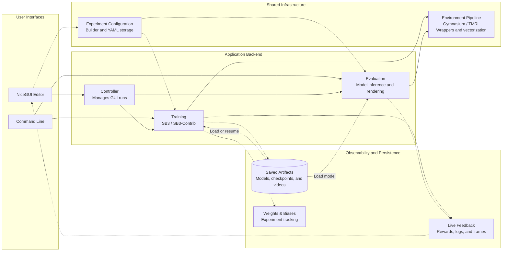

# Architecture

QDrive is a thin layer over Stable-Baselines3. It expands SB3's capabilities by providing a gui to simplify
configuration. Capabilities are inferred dynamically allowing for plug and play inclusion of new environments, wrappers,
and algorithms.

## Modules

| Package               | Responsibility                                                                    |
|-----------------------|-----------------------------------------------------------------------------------|
| `backend`             | Core of the QDrive wrapper. Contains the logic used for training and evaluation.  |
| `backend/callbacks`   | Custom SB3 callbacks used during training for milestones, evaluation and logging. |
| `backend/config`      | Experiment Configuration containter, builder and storage related helpers          |
| `backend/env`         | Environment building, custom environments and wrappers                            |
| `backend/state`       | Storage of live training data                                                     |
| `frontend`            | Gui built in NiceGUI and gui related helpers                                      |
| `frontend/components` | Editor subcomponents                                                              |
| `util`                | General utility functions and classes                                             |

## Decisions

**Configuration is generated from signatures.**
The GUI builds its forms by inspecting the signatures of relevant classes and functions. (`util/inspection_helper.py`,
`frontend/uiutils.py`)
The plain values returned by the ui elements are converted by the `ConfigBuilder`, which results in a nested dictionary
that can then be exported as YAML.

**One run at a time**
When the gui is used, only one training or evaluation can be active at a time. This is due to the `Controller`, which
starts a daemon thread and refuses to start another one while one is alive.
The daemon is stopped by clearing a `running` event.
The cli skips the controller and runs in the main thread. SIGINT is wired to gracefully stop QDrive, which includes
clearing the `running` event and letting sb3 finish its work.

**Streaming to many browsers/devices.**
Multiple clients can follow the training/evaluation at the same time. It is also possible for clients other than the one
that started a run to stop it. The training history can be rebuilt up to a certain degree if a client joins during
training or if a client reconnects.

**Resumable runs.**
The best model and the latest checkpoint model can be used to resume training. If available `VecNormalize` statistics
and optionally, the replay buffer will be used as well.

**Overrides of parameters depending on usage**
Certain wrappers or parameters may require different options depending on if they are used during training or
evaluation. An example of this is `VecNormalize`, which requires different options to prevent moving statistics during
evaluation. QDrive exposes these overrides in `overrides.yaml`.

## Limitations

- Only one training or evaluation run can be active at a time
- Training always creates a W&B run (use `--offline` without an account)
- Trackmania/TMRL runs a single real-time environment and doesn't allow for distributed training

## Possible extensions and improvements

- Hyperparameter optimization using tools like [Optuna](https://optuna.org/)
- Imitation learning: mainly blocked by dependency conflicts due to
  outdated [imitation](https://github.com/HumanCompatibleAI/imitation) dependencies
- Better TMRL integration by not using the provided environment
- Allow for both training and evaluation at the same time